<div align="center">

# The Fastest Kettle

### 1 litre of water. 29.5 seconds. Four junkyard car batteries and a PCB.


**[▶ Watch the build (YouTube)](https://www.youtube.com/watch?v=0xC_Ypls5T8)** · **[𝕏 thread](https://x.com/jlcjak/status/2119211496416907727)**

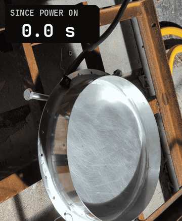

*The real thing, sped up 4×: 1050 ml of 12 °C water, contactor closes, the whole floor goes white within half a second,
and it's boiling at **29.5 s**.*

</div>

---

## The idea in 20 seconds

A kitchen kettle is about 2 kW, so a litre takes ~3 minutes. The Impulse Labs battery cooktop does ~10 kW and boils
a litre in ~40 s. We wanted to beat it for a few hundred euros.

1. **Get ~15 kW.** Four used car batteries in series (48 V) happily dump 400 A for half a minute. That's literally what their
   "cold cranking amps" rating tests.
2. **Turn it into heat without melting anything.** One long copper track on an **aluminium-core PCB**: 18 mm wide,
   2.7 m long, **65 mΩ**. The copper faces down (dry), the bare aluminium faces up (wet), and a 3 kV dielectric sits between them.
3. **Make the board the pot.** A stainless cake ring siliconed on top. That's it. That's the kettle.

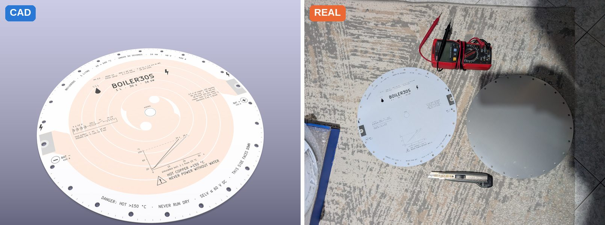

## From CAD to the real thing

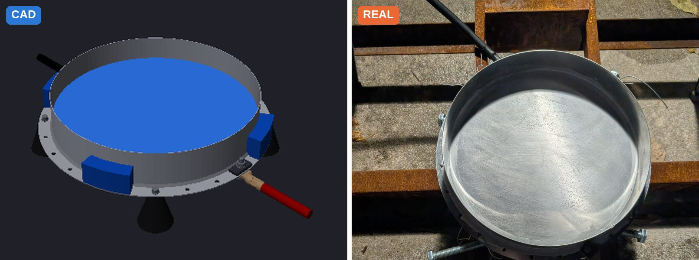
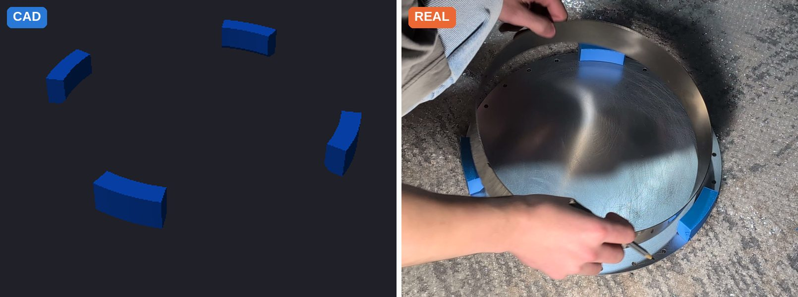
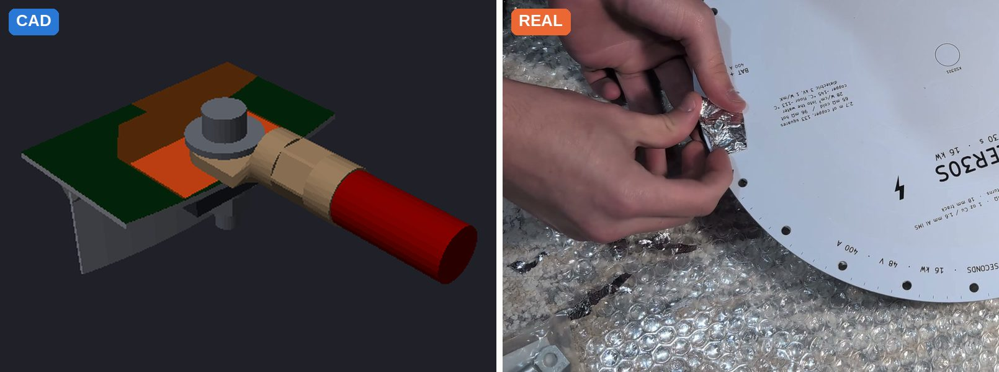

*Top: the kettle. In real life we skipped the printed feet and lashed it to a steel frame. Middle: 4 push-fit printed
blocks hold the cake ring centred while the silicone cures. Bottom: the 35 mm² cable lug bolts straight onto the
heater pad. No busbars.*

## Results (Nov 7 2026, outdoors, 12 °C)

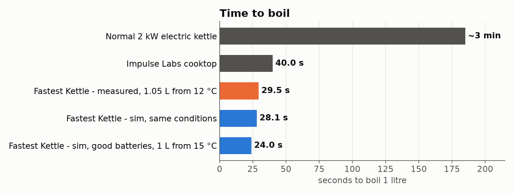

| | |
|---|---|
| Water | **1050 ml**, weighed, starting at ~12 °C |
| Time to first boil | **29.5 s** |
| Average power into the water | **~13.1 kW** (387 kJ / 29.5 s) |
| Simulated, same water and batteries | 28.1 s, close enough to be happy |
| Simulated, good batteries, 1 L from 15 °C | 24 s |

## How it went

<table>
<tr>
<td width="50%">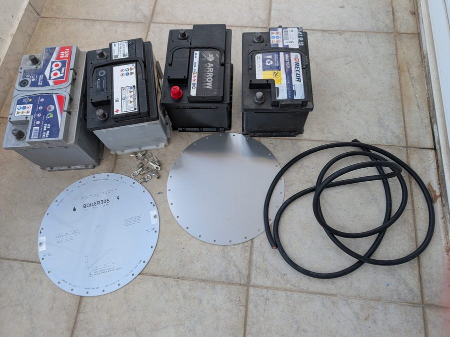<br>
<sub><b>The whole bill of materials.</b> Four used car batteries, the heater boards (white = copper side, grey = water side), 3 m of welding cable.</sub></td>
<td width="50%">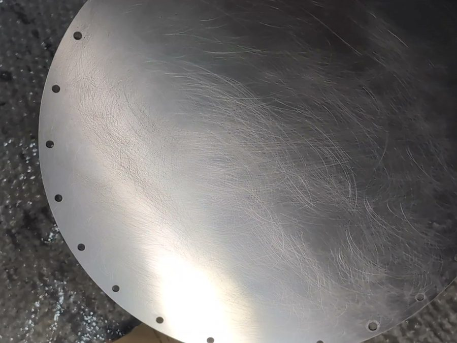<br>
<sub><b>Sanded for bubbles.</b> Someone who knows boiling warned us about a steam layer cooking the board. Roughening the surface gives bubbles more places to start and buys ~10-30 % extra margin.</sub></td>
</tr>
<tr>
<td>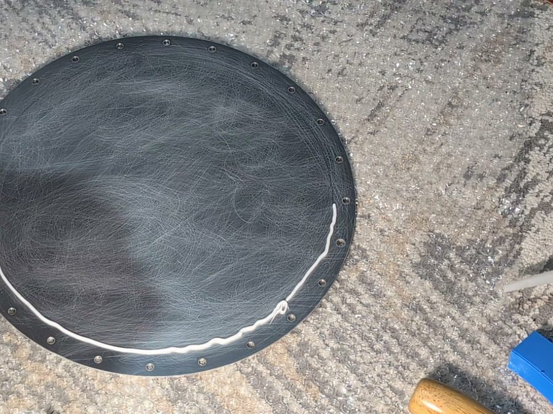<br>
<sub><b>Silicone bead</b>, ring down onto the printed blocks, then a second pass on the inside seam.</sub></td>
<td>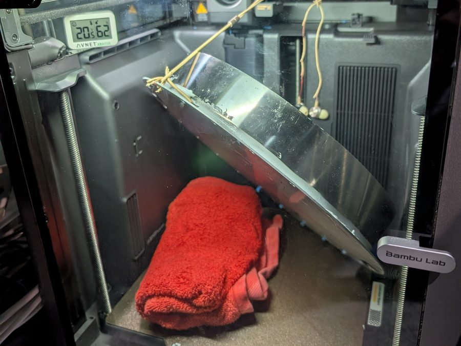<br>
<sub><b>Cured overnight hanging inside a 3D printer</b>, because silicone cures faster warm and humid: about 34 °C and 85 % humidity.</sub></td>
</tr>
<tr>
<td>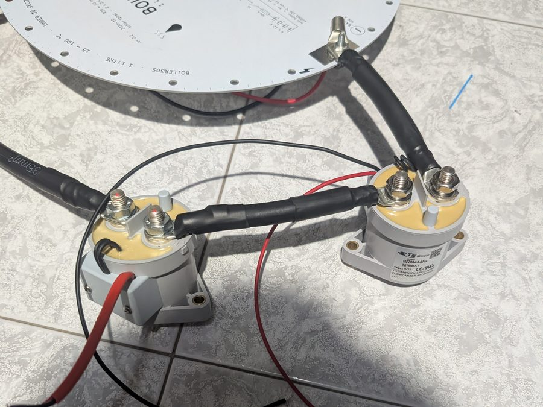<br>
<sub><b>Two EV contactors in series</b> on a hand-held button. If one welds shut, the other still opens.</sub></td>
<td>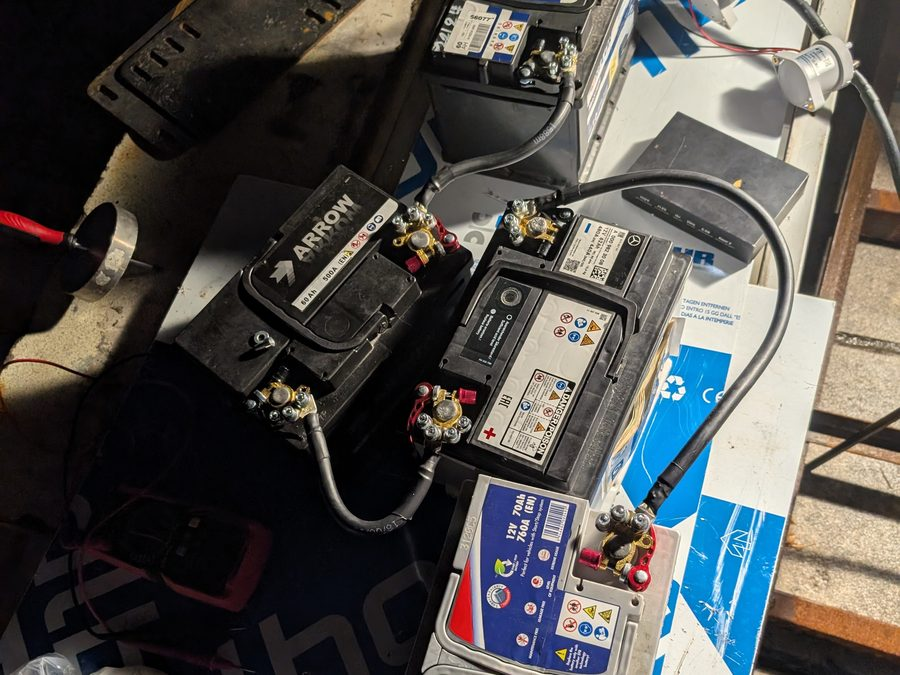<br>
<sub><b>48 V of car batteries</b> from four different brands, quick-release clamps, ~400 A.</sub></td>
</tr>
<tr>
<td>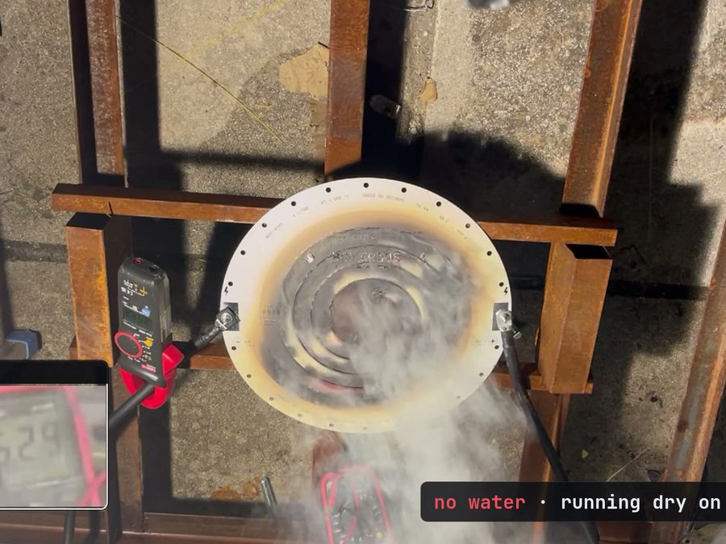<br>
<sub><b>Then we ran it dry on purpose.</b> The white soldermask goes yellow, then brown…</sub></td>
<td>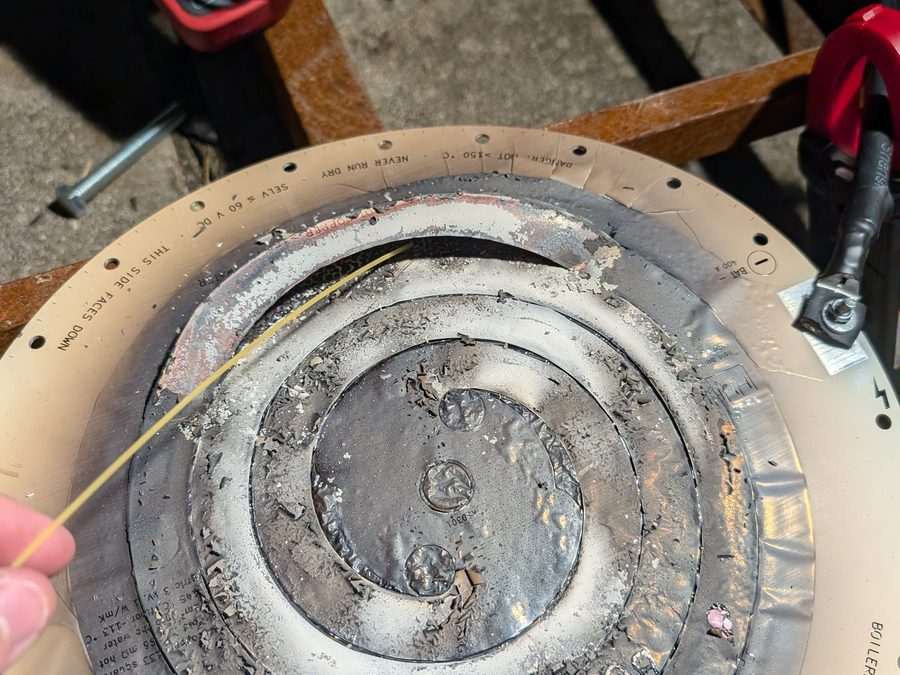<br>
<sub><b>…and the copper lets go.</b> It took longer than expected, but the silkscreen says <i>NEVER POWER WITHOUT WATER</i> for a reason.</sub></td>
</tr>
</table>

## Why the board survives 15 kW (with water in it)

- **Boiling is an absurdly good coolant.** 28 W/cm² leaves the aluminium with only ~13 °C of superheat (~113 °C). The copper
  on the dry side runs ~145 °C.
- **Hot spots were simulated on the real copper and fixed.** A 2D current-flow solve found 5× hot spots at sharp corners.
  Rev 2.2 rounds them off.

Full write-up with the plots: **[docs/heater_physics.md](docs/heater_physics.md)**.

## Build your own

- **Everything you need, with links and prices: [docs/BUILD.md](docs/BUILD.md)**
- **Total:** about €300, including the batteries and a 5-board PCB order.

The short version:
1. Order the heater (gerbers are in [`heater/`](heater)).
2. Sand the wet side.
3. Silicone on a Ø28 cm cake ring, using the printed jig. **Use aquarium silicone**: it handles the heat better and is the
   food-safe choice. We used a generic one and it's rated only to 120 °C.
4. Bolt the lugs straight onto the pads. Printed feet are included, but the 35 mm² cables are stiff and can drag or tip the
   kettle, so you may still need to tie it down. We skipped the feet and lashed the board to a steel frame.
5. Wire 4 car batteries through **two EV200 contactors in series** on a hold-to-run button.

## What's in here

```
heater/       KiCad board + Python generator (the spiral is code, not hand-drawn) + JLCPCB gerbers
cad/step/     STEP models: assembly, exploded view, heater, ring, feet, jig, lug, terminal
cad/stl/      print-ready: feet (PC) and centering-jig blocks (PLA/PETG)
cad/freecad/  parametric FreeCAD scripts that build all of the above
sim/          boil-time model, layer temperatures, 2D current-flow / hot-spot solver, result plots
docs/         build guide + parts list, heater physics
```

The heater is fully parametric: change the track width, resistance target or diameter in `heater/gen_heater.py`, then run
`python3 heater/gen_heater.py` (it needs KiCad's `pcbnew` Python module).

## ⚠️ Safety

This is not a product. It's a 48 V, 400 A, 15 kW experiment.

- **Never power it without water.** At full power a dry board is ruined within seconds, and there's **no thermal
  cut-off** in this version. Your thumb on the button is the only off switch.
- **Fit a fuse** (500 A, rated ≥ 80 V DC) at the battery. A short on four car batteries is 2,000-3,000 A, and the heater
  current never gets high enough to blow it, so it's only there for wiring faults.
- **Two contactors in series**, so one welded contact can't leave it stuck on. Hold-to-run only.
- Stand back, wear eye protection, and keep it outdoors or well ventilated. Lead-acid batteries vent hydrogen.
- Never pour water onto a hot, dry plate (Leidenfrost: it can stay in film boiling and keep heating).
- Tie it down, and lift it by the board, never by the siliconed ring.

## Credits

Built by [@jlcjak](https://x.com/jlcjak). Designed with the help of an AI hardware agent
(Backplane): sizing, heater layout, the boiling and current-flow sims, and the CAD.

Released under the [MIT License](LICENSE). Build it, break it, beat the time.
