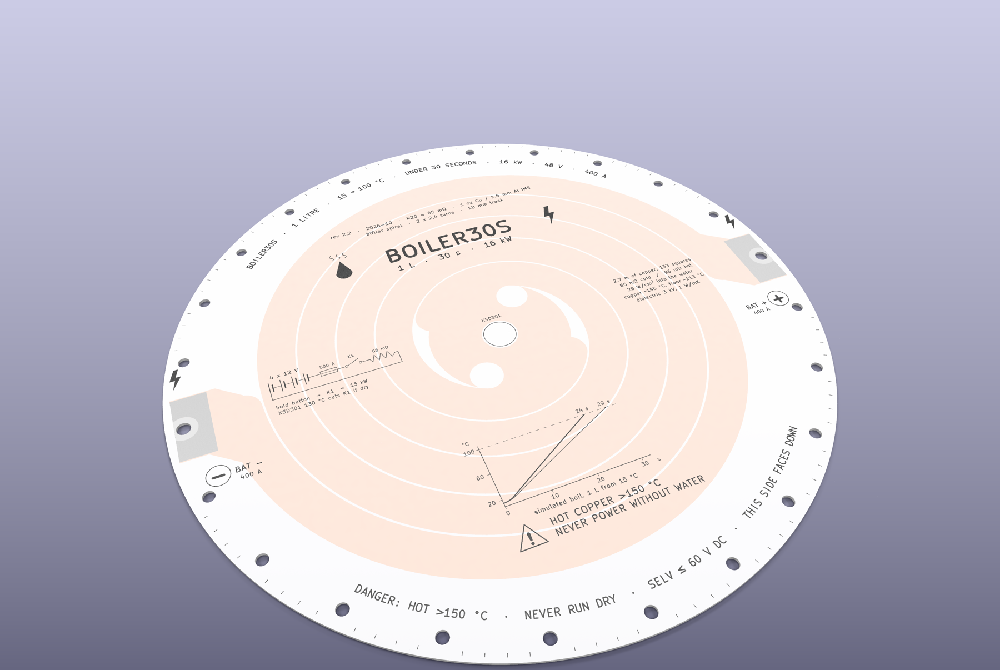
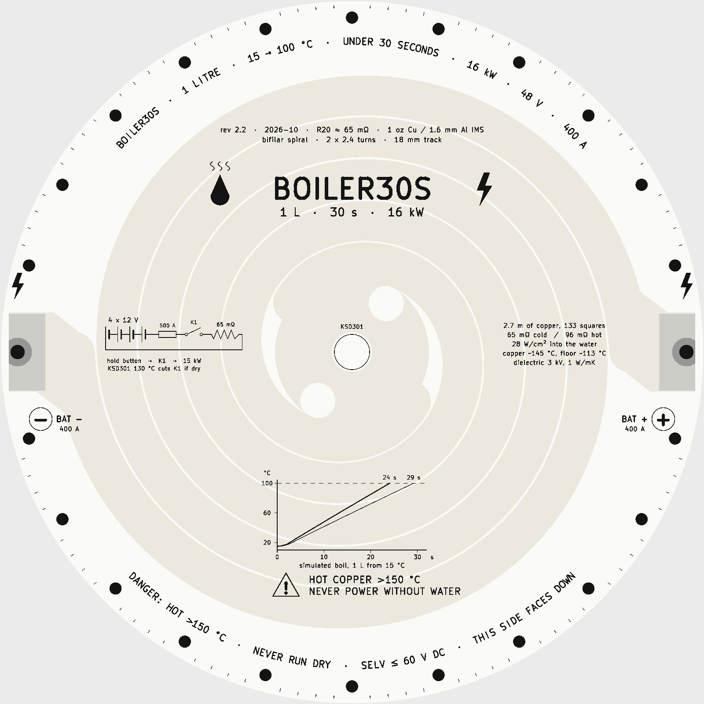
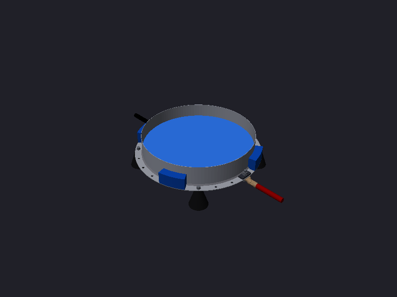
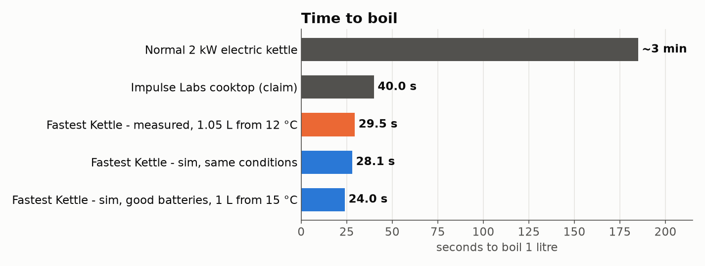
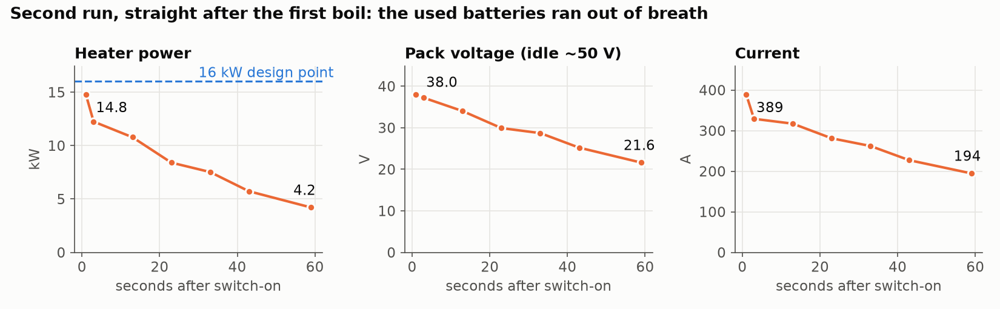
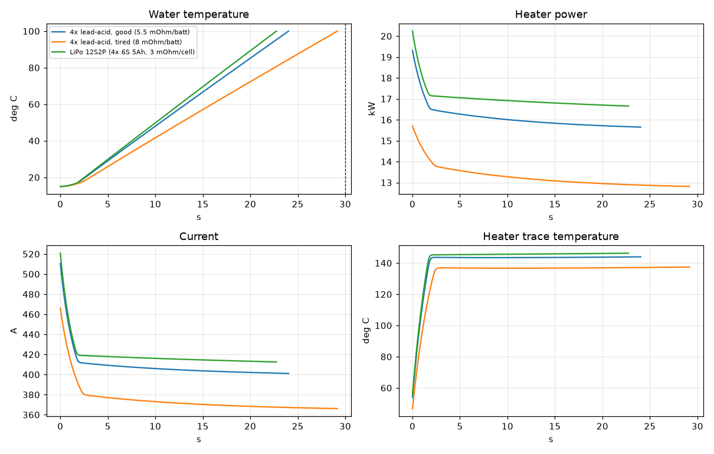
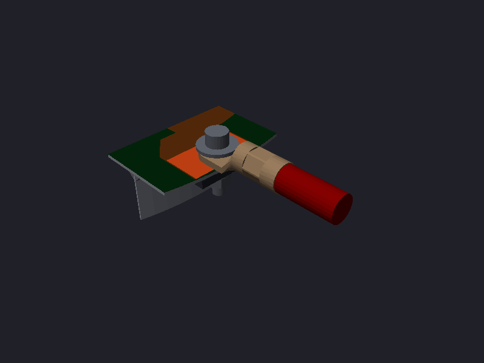
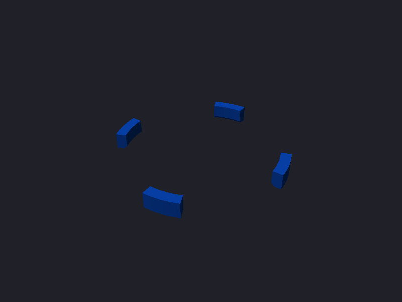

<div align="center">

# The Fastest Kettle

### 1 litre of water. 29.5 seconds. Four junkyard car batteries and a PCB.


**[▶ Watch the build (YouTube)](https://www.youtube.com/watch?v=0xC_Ypls5T8)** · **[𝕏 thread](https://x.com/jlcjak/status/2119211496416907727)**



*The whole heater is one PCB. The copper spiral is the heating element, and the board's aluminium back is the bottom of the pot.*

</div>

---

## The idea in 20 seconds

A kitchen kettle is about 2 kW, so a litre takes ~3 minutes. The Impulse Labs battery
cooktop does ~10 kW and claims ~30-40 s. We wanted to beat it for a few hundred euros.

1. **Get ~15 kW.** Four used car batteries in series (48 V) happily dump 400 A for half a minute. That's literally what their
   "cold cranking amps" rating tests.
2. **Turn it into heat without melting anything.** One long copper track on an **aluminium-core PCB**: 18 mm wide,
   2.7 m long, **65 mΩ**. The copper faces down (dry), the bare aluminium faces up (wet), and a 3 kV dielectric sits between them.
3. **Make the board the pot.** A stainless cake ring siliconed on top. That's it. That's the kettle.

<p align="center">
  
  
</p>
<p align="center"><i>Left: the copper side, black silk on white mask. Right: the full kettle (heater, cake ring, 4 printed feet, two bolted-on cable lugs).</i></p>

## Results (Nov 7 2026, outdoors, 12 °C)



| | |
|---|---|
| Water | **1050 ml**, weighed, starting at ~12 °C |
| Time to first boil | **29.5 s** |
| Average power into the water | **~13.1 kW** (387 kJ / 29.5 s) |
| Peak measured power | **14.8 kW** (38 V × 389 A) |
| Simulated, same water and batteries | 28.1 s, close enough to be happy |
| Simulated, good batteries, 1 L from 15 °C | 24 s |

We then tried a second run straight away, with meters on the pack, and it never boiled. The used batteries were
already exhausted from the first run:



**Lesson: the kettle is fine, the batteries are the bottleneck.** A fresher bank (or a 12S2P LiPo pack) is the
obvious next step.

Afterwards it doubled as a **12 kW frying pan** (souvlaki, eggs, spaghetti). Then we flipped it over and powered it dry
on purpose: the white soldermask yellowed and the copper spiral burned open within seconds. The silkscreen
says *NEVER POWER WITHOUT WATER* for a reason.

## Why the board survives 15 kW



- **Boiling is an absurdly good coolant.** 28 W/cm² leaves the aluminium with only ~13 °C of superheat (~113 °C). The copper
  on the dry side runs ~145 °C.
- **The real enemy is the boiling crisis.** Past ~111-144 W/cm², the bubbles merge into a steam blanket and the floor runs
  away. We sit at 28 W/cm² on average and ~50 W/cm² at the worst spots, about **2× margin**. Sanding the wet side adds a
  bit more.
- **Hot spots were simulated on the real copper and fixed.** A 2D current-flow solve found 5× hot spots at sharp corners.
  Rev 2.2 rounds them off.

Full write-up: **[docs/heater_physics.md](docs/heater_physics.md)**.

## Build your own

- **Everything you need, with links and prices: [docs/BUILD.md](docs/BUILD.md)**
- **Total:** about €300, including the batteries and a 5-board PCB order.

<p align="center">
  
  
  
</p>
<p align="center"><i>The 35 mm² lug bolts straight onto the pad with an insulating shoulder washer · 4 push-fit blocks centre the ring while the silicone cures · 4 PC feet</i></p>

The short version:
1. Order the heater (gerbers are in [`heater/`](heater)).
2. Sand the wet side.
3. Silicone on a Ø28 cm cake ring, using the printed jig. **Use aquarium silicone**: it handles the heat better and is the
   food-safe choice. We used a generic one and it's rated only to 120 °C.
4. Bolt on the lugs and print the feet.
5. Wire 4 car batteries through **two EV200 contactors in series** on a hold-to-run button.

## What's in here

```
heater/       KiCad board + Python generator (the spiral is code, not hand-drawn) + JLCPCB gerbers
cad/step/     STEP models: assembly, exploded view, heater, ring, feet, jig, lug, terminal
cad/stl/      print-ready: feet (PC) and centering-jig blocks (PLA/PETG)
cad/freecad/  parametric FreeCAD scripts that build all of the above
sim/          boil-time model, layer temperatures, 2D current-flow / hot-spot solver, result plots
docs/         build guide + parts list, heater physics
```

The heater is fully parametric: change the track width, resistance target or diameter in `heater/gen_heater.py`, then run
`python3 heater/gen_heater.py` (it needs KiCad's `pcbnew` Python module).

## ⚠️ Safety

This is not a product. It's a 48 V, 400 A, 15 kW experiment.

- **Never power it without water.** A dry board goes from fine to burnt in a few seconds. There's **no thermal cut-off**
  in this version, so your thumb on the button is the only off switch.
- **Fit a fuse** (500 A, rated ≥ 80 V DC) at the battery. A short on four car batteries is 2,000-3,000 A, and the heater
  current never gets high enough to blow it, so it's only there for wiring faults.
- **Two contactors in series**, so one welded contact can't leave it stuck on. Hold-to-run only.
- Stand back, wear eye protection, and keep it outdoors or well ventilated. Lead-acid batteries vent hydrogen.
- Never pour water onto a hot, dry plate (Leidenfrost: it can stay in film boiling and keep heating).
- Lift it by the board or the feet, never by the siliconed ring.

## Credits

Built by [@jlcjak](https://x.com/jlcjak). Designed with the help of an AI hardware agent
(Backplane): sizing, heater layout, the boiling and current-flow sims, and the CAD.

Released under the [MIT License](LICENSE). Build it, break it, beat the time.
