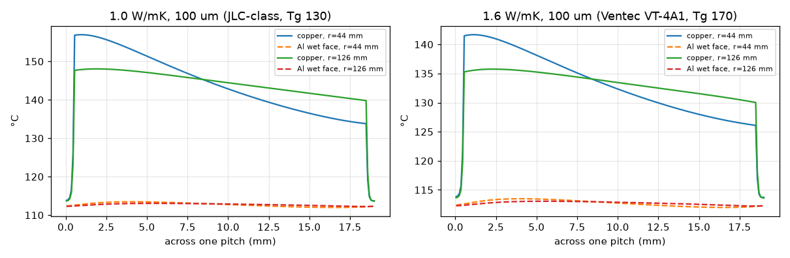
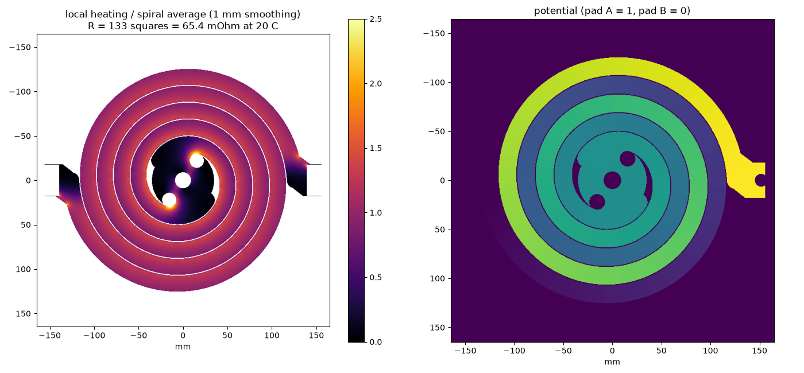

# Heater physics, in one page

All numbers come from the scripts in [`sim/`](../sim): `sizing.py` (boil time), `heater_check.py` (layer
temperatures), `heater_raster.py` + `heater_currentflow.py` (2D current flow over the real copper).

## The heater
| | |
|---|---|
| Board | 1-layer aluminium-core PCB, Ø320 × 1.6 mm, 1 oz copper, 1 W/mK dielectric (JLCPCB standard) |
| Copper | bifilar Archimedean spiral, 18 mm track, 1 mm gap, ~2.7 m long, 133 squares |
| Resistance | **65.4 mΩ at 20 °C**, ~96 mΩ hot (copper TCR +0.39 %/K) |
| Heated area | 573 cm² (Ø270), inside a Ø280 cake ring |
| Design point | ~16 kW at ~40 V / ~410 A under load |

## Why it doesn't melt: boiling is ridiculously good at cooling
- 16 kW over 573 cm² is **28 W/cm²**.
- Nucleate boiling moves that with only **~13 °C** of wall superheat, so the aluminium floor sits at about 113 °C. That's a
  heat-transfer coefficient of ~20,000 W/m²K, 20-40× what non-boiling water manages.
- Heat flux scales with superheat cubed, so even 3× worse boiling only raises the floor to ~119 °C.
- The copper on the dry side runs ~30 °C hotter than the floor (the dielectric drop): ~145 °C typical, ~160 °C at the spiral's
  inner edges, ~185 °C in two small centre spots.

## The real limit: the boiling crisis (critical heat flux)
- Above the **critical heat flux** (CHF), the bubbles merge into a steam film (film boiling, the Leidenfrost effect) and the
  floor runs away by hundreds of °C.
- For saturated water on a flat, upward-facing plate, CHF is **111-144 W/cm²**.

| | flux | margin to CHF |
|---|---|---|
| average | 28 W/cm² | ~4-5× |
| hottest spots (after spreading in the aluminium) | ~45-55 W/cm² | **~2×** |
| while the water is still below 100 °C | — | CHF is 2-5× higher, so the start of the boil is the safe part |

Sanding the wet side (random-orbit, 120-240 grit, then degrease) adds nucleation sites and wetting: roughly +10-30 % CHF.

## Hot spots, from the real copper shape
- The first layout had sharp crescent tips where the two arms meet (5× average power density) and a sharp inside corner at
  each terminal (3.7×).
- Rev 2.2 adds 8 mm round reliefs and chamfers: ≤2.4× in two ~0.3 cm² spots, ≤1.5× everywhere else.

## Terminals without busbars
- The cable lug bolts straight onto the pad.
- The current-flow solve says the dry copper just outside the water dissipates ~25 W per terminal, against ~4 W with a
  copper busbar. The pad edge runs ~20-30 °C hotter than the floor, which is fine.
- Contact is only ~1 cm², so prep matters: Scotch-Brite both faces, no grease, 8 N·m, and check for < 1 mV at 20 A.

## Dry = dead
- With no water the floor heats at ~75 K/s.
- Within a few seconds the dielectric cooks, the copper lifts, and the trace burns open (48 V at 400 A can also arc).
- We tested this on purpose: the white soldermask yellowed, then the spiral burned through.
